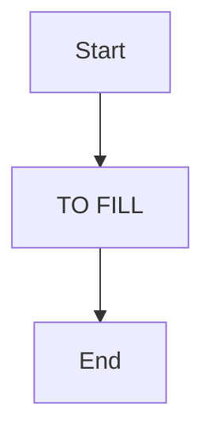

# Application Flow (APPFLOW)

> **Status: DRAFT.** Flows must match observable behaviour or an approved
> specification. Mark unverified flows `NOT_PROVEN` in the Evidence column.

## 1. Actors

| Actor | Description | Authentication | Evidence |
|---|---|---|---|
| `[TO FILL]` | `[TO FILL]` | `[TO FILL]` | `[TO FILL]` |

## 2. Entry points

| Entry point | URL / command / event | Auth required | Evidence |
|---|---|---|---|
| `[TO FILL]` | `[TO FILL]` | yes/no | `[TO FILL]` |

## 3. Primary flows

### Flow F-001 — `[TO FILL: name]`

- Trigger: `[TO FILL]`
- Preconditions: `[TO FILL]`
- Steps:
  1. `[TO FILL]`
  2. `[TO FILL]`
- Success outcome: `[TO FILL]`
- Failure branches: `[TO FILL]`
- Data written: `[TO FILL]`
- Evidence: `[TO FILL: test, manual run, screenshot, log]`

## 4. State transitions

| Entity | From | Event | To | Guard | Side effects |
|---|---|---|---|---|---|
| `[TO FILL]` | `[TO FILL]` | `[TO FILL]` | `[TO FILL]` | `[TO FILL]` | `[TO FILL]` |

## 5. Error and recovery paths

| Condition | User-visible behaviour | System behaviour | Recovery | Evidence |
|---|---|---|---|---|
| `[TO FILL]` | `[TO FILL]` | `[TO FILL]` | `[TO FILL]` | `[TO FILL]` |

## 6. Permissions and roles

See `SECURITY.md` for the authoritative permission model. Summarise the flow
impact only.

## 7. Open questions

| ID | Question | Owner | Status |
|---|---|---|---|
| AF-Q1 | `[TO FILL]` | `[TO FILL]` | open |
