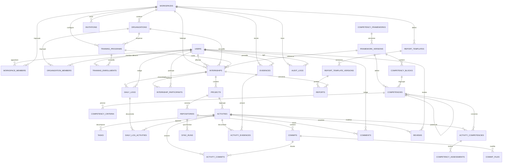

# MCD — Modèle conceptuel de données

> Modèle conceptuel (entités, relations, cardinalités). Le modèle physique
> (types, clés, contraintes) est dans `MLD.md`.

## 1. Diagramme global

## 2. Entités et attributs conceptuels

| Entité | Attributs principaux |
|---|---|
| USERS | id, name, email, password_hash, status, last_login_at, created_at |
| WORKSPACES | id, name, type, owner_id, status, created_at |
| WORKSPACE_MEMBERS | id, workspace_id, user_id, role, status, joined_at |
| ORGANIZATIONS | id, workspace_id, name, type, contact_email, contact_phone, address |
| ORGANIZATION_MEMBERS | id, organization_id, user_id, role, status |
| TRAINING_PROGRAMS | id, workspace_id, organization_id, name, certification, start_date, end_date |
| TRAINING_ENROLLMENTS | id, user_id, training_program_id, start_date, end_date, status |
| COMPETENCY_FRAMEWORKS | id, name, issuing_authority, description, status |
| FRAMEWORK_VERSIONS | id, framework_id, version, effective_date, status, published_at |
| COMPETENCY_BLOCKS | id, framework_version_id, code, title, description, position |
| COMPETENCIES | id, framework_version_id, block_id, parent_id, code, title, description, position |
| COMPETENCY_CRITERIA | id, competency_id, label, description, position |
| INTERNSHIPS | id, workspace_id, trainee_id, host_organization_id, training_program_id, framework_version_id, title, start_date, end_date, objectives, status |
| INTERNSHIP_PARTICIPANTS | id, internship_id, user_id, role, permissions, status |
| PROJECTS | id, internship_id, name, description, status, start_date, end_date |
| ACTIVITIES | id, project_id, title, description, type, status, priority, start_date, end_date, objectives, results, difficulties, solutions |
| TASKS | id, activity_id, title, description, priority, status, due_date, acceptance_criteria, position |
| DAILY_LOGS | id, internship_id, author_id, work_date, start_time, end_time, duration_minutes, objectives, work_done, difficulties, solutions, results, remaining, private_notes, status |
| DAILY_LOG_ACTIVITIES | id, daily_log_id, activity_id, contribution |
| REPOSITORIES | id, project_id, provider, external_id, name, repository_url, default_branch, last_synced_at |
| COMMITS | id, repository_id, sha, author_name, author_email, github_author, committed_at, message, branch, url, imported_at |
| COMMIT_FILES | id, commit_id, path, change_type, additions, deletions |
| ACTIVITY_COMMITS | id, activity_id, commit_id, linked_by, linked_at |
| SYNC_RUNS | id, repository_id, provider, started_at, completed_at, status, items_imported, error_summary |
| EVIDENCES | id, workspace_id, owner_id, title, type, description, demonstrated, storage_key, external_url, visibility, captured_at |
| ACTIVITY_EVIDENCES | id, activity_id, evidence_id, note |
| ACTIVITY_COMPETENCIES | id, activity_id, competency_id, justification, status, documented_at |
| COMPETENCY_ASSESSMENTS | id, activity_competency_id, assessor_id, appreciation, status, assessed_at |
| COMMENTS | id, activity_id, author_id, content, visibility, created_at |
| REVIEWS | id, activity_id, reviewer_id, status, feedback, created_at |
| INVITATIONS | id, workspace_id, email, role, token_hash, expires_at, accepted_at |
| REPORT_TEMPLATES | id, workspace_id, name, type, description, status |
| REPORT_TEMPLATE_VERSIONS | id, template_id, version, schema_json, published_at |
| REPORTS | id, internship_id, template_version_id, generated_by, generated_at, file_path, status |
| AUDIT_LOGS | id, workspace_id, actor_id, action, subject_type, subject_id, metadata, ip, user_agent, created_at |

## 3. Cardinalités et règles de lecture

| Relation | Cardinalité | Règle |
|---|---|---|
| WORKSPACES ↔ USERS | N-N via WORKSPACE_MEMBERS | un utilisateur peut appartenir à plusieurs workspaces avec des rôles distincts |
| WORKSPACES → INTERNSHIPS | 1-N | un stage appartient à un seul workspace |
| INTERNSHIPS → PROJECTS | 1-N | un projet appartient à un seul stage |
| PROJECTS → ACTIVITIES | 1-N | une activité appartient à un seul projet |
| ACTIVITIES → TASKS | 1-N | une tâche peut exister sans activité (facultatif : `activity_id` nullable) |
| DAILY_LOGS ↔ ACTIVITIES | N-N via DAILY_LOG_ACTIVITIES | une journée peut concerner plusieurs activités |
| REPOSITORIES → COMMITS | 1-N | unicité (repository_id, sha) |
| ACTIVITIES ↔ COMMITS | N-N via ACTIVITY_COMMITS | plusieurs commits par activité |
| ACTIVITIES ↔ EVIDENCES | N-N via ACTIVITY_EVIDENCES | une preuve peut démontrer plusieurs activités |
| ACTIVITIES ↔ COMPETENCIES | N-N via ACTIVITY_COMPETENCIES | justification obligatoire |
| ACTIVITY_COMPETENCIES → COMPETENCY_ASSESSMENTS | 1-N | évaluations datées et nominatives |
| INTERNSHIPS → REPORTS | 1-N | un rapport concerne un stage et une version de modèle |

## 4. Contraintes conceptuelles majeures

1. Une compétence appartient à **une** version de référentiel (INV-07).
2. Une version publiée est immuable (INV-08) : aucune mise à jour des blocs,
   compétences ou critères après `published_at`.
3. Un commit est unique par dépôt et SHA (INV-05).
4. Une activité appartient à un projet, lui-même rattaché à un stage et un
   workspace (INV-02).
5. Un journal possède un auteur et un stage (INV-03).
6. Toute relation entre entités de workspaces différents est interdite (INV-11).
7. Une preuve possède un propriétaire et une visibilité (INV-06).
